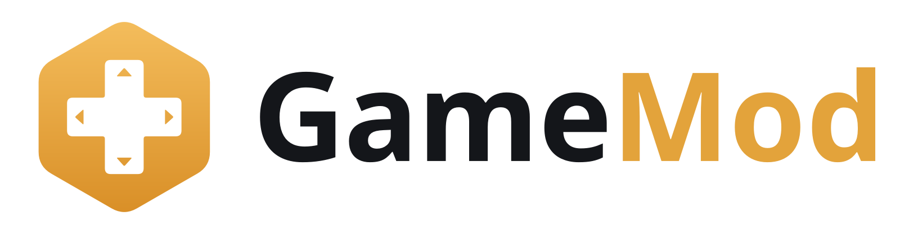

<p align="center">
  <picture>
    <source media="(prefers-color-scheme: dark)" srcset="assets/logo/gamemod-logo-on-dark.png">
    
  </picture>
</p>

<p align="center">
  <b>Hindi subtitles for PC games. One switch to turn them on, one to turn them off.</b><br>
  आपके PC गेम्स के लिए हिन्दी सबटाइटल
</p>

<p align="center">
  <a href="../../releases/latest"><b>⬇ Download the latest GameMod.zip</b></a>
</p>

GameMod adds Hindi subtitles, written in Devanagari, to games that don't have them. The voices stay as they are, and what the characters say shows on screen in Hindi.

## Games

| Game | Hindi lines | Pick this in the game |
|---|---:|---|
| The Last of Us Part I | 46,084 | Options > Language > Subtitles > **हिन्दी** |
| Resident Evil 2 | 1,709 | Options > Language > Display Language > **Polish [pl]** |
| Marvel's Spider-Man Remastered | 34,738 | Settings > Text Language > **Danish** |

These are the Steam versions on Windows. Resident Evil 2 and Spider-Man have no spare place for a new language, so the Hindi goes where Polish or Danish would be, and the game's menu still shows that name. Your English menus and voices don't change.

## How to use

1. Download **GameMod.zip** from the [latest release](../../releases/latest) and unzip it. Keep `GameMod.exe` and the `subtitles` folder together.
2. Close the game.
3. Double-click `GameMod.exe`. If Windows says "Windows protected your PC", click **More info**, then **Run anyway**. Windows shows this for apps from small developers that haven't paid for a code-signing certificate.
4. Your games are listed on the left. A green tick means the game was found. A red cross means GameMod couldn't find it: click **Choose game folder** and pick the game's folder.
5. Click the game and turn on the **Hindi Subtitles** switch.
6. Start the game and pick the language shown in the table above.

**To go back to English**, choose English in the same game menu. **To remove the mod completely**, close the game and turn the switch off. Steam's *Verify integrity of game files* also puts the game back to normal.

**After a game update**, the switch may turn itself off. Turn it on again; your subtitles are kept.

## Good to know

- You need your own copy of the game. GameMod contains no game files.
- Only subtitles change. Menus, item names and in-game notes stay in English.
- The translations were made with AI models (Google Gemini and Anthropic Claude) using a guide for names, tone and gender. Every line was checked automatically for subtitle timing, numbers and leftover English, and the games were tested by playing them. Some lines will still read oddly. Please [suggest a better line](../../issues/new?template=translation_fix.yml).
- If GameMod says Windows blocked it, right-click `GameMod.exe` and choose **Run as administrator**.

## Report a problem

- [Something doesn't work](../../issues/new?template=bug_report.yml), such as GameMod not starting, the switch failing, or boxes or English showing in the game.
- [A Hindi line is wrong](../../issues/new?template=translation_fix.yml).

## For developers

GameMod is a Python 3.11 app for Windows with a PySide6 interface.

```bat
python -m venv .venv
.venv\Scripts\pip install -r requirements.txt pyinstaller
.venv\Scripts\python -m pytest
.venv\Scripts\python -m gamemod.main
```

Tests that need a real game skip themselves when the game isn't installed.

### How it's laid out

| Folder | What's in it |
|---|---|
| `gamemod/adapters/` | One folder per game: reading the game's files, finding its subtitle lines, and installing the mod. `base.py` describes what a game must provide. |
| `gamemod/core/` | Shared by all games: the translation database, the Gemini translator, quality checks, the Hindi font builder, and safe install and uninstall. |
| `gamemod/ui/` | The app's screens. |
| `subtitles/` | The finished Hindi packs that ship with the app, one per game. |
| `tools/` | Build, release and batch translation scripts. |

The command line runs the same steps as the app, for example `python -m gamemod.cli --game msmr status`. See `gamemod/cli.py` for the full list.

### Adding a game

Write an adapter in `gamemod/adapters/<game>/` that subclasses `GameAdapter`, add a `glossary.yaml` with names and tone for the translator, and register it in `gamemod/adapters/registry.py`. The translator, review screen, checks and font building are shared.

### Making a release

1. Export the subtitle packs and commit them: `python -m gamemod.cli --game <id> export-pack`.
2. Add a section to `CHANGELOG.md` headed `## vX.Y.Z`.
3. Push a tag: `git tag vX.Y.Z` then `git push origin vX.Y.Z`.

The Release workflow runs the tests, builds `GameMod.exe` on GitHub, zips it with the `subtitles` folder and a short guide, and publishes it with a SHA-256 checksum. To build locally instead, run `build.bat`.

## License

The code is under the [MIT License](LICENSE). Noto Sans Devanagari, in `assets/fonts`, is under the [SIL Open Font License](assets/fonts/OFL.txt).

GameMod is an unofficial fan project. It is not affiliated with or endorsed by Naughty Dog, Sony Interactive Entertainment, Capcom, Insomniac Games, Marvel or Valve. All game names are trademarks of their owners.
